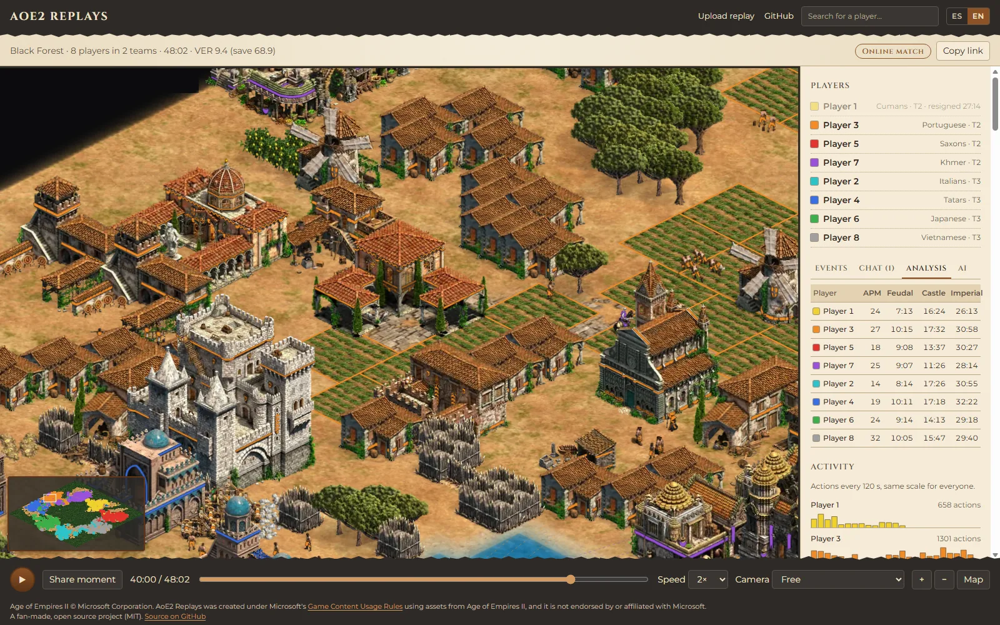
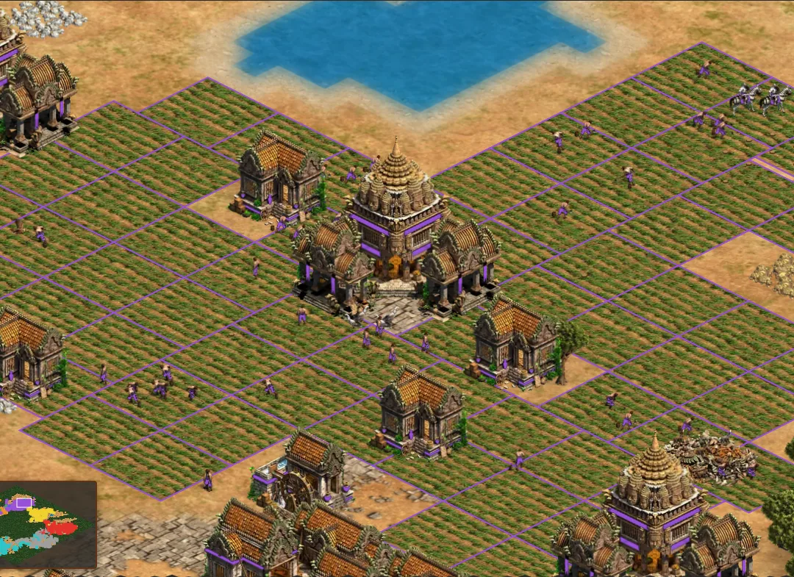
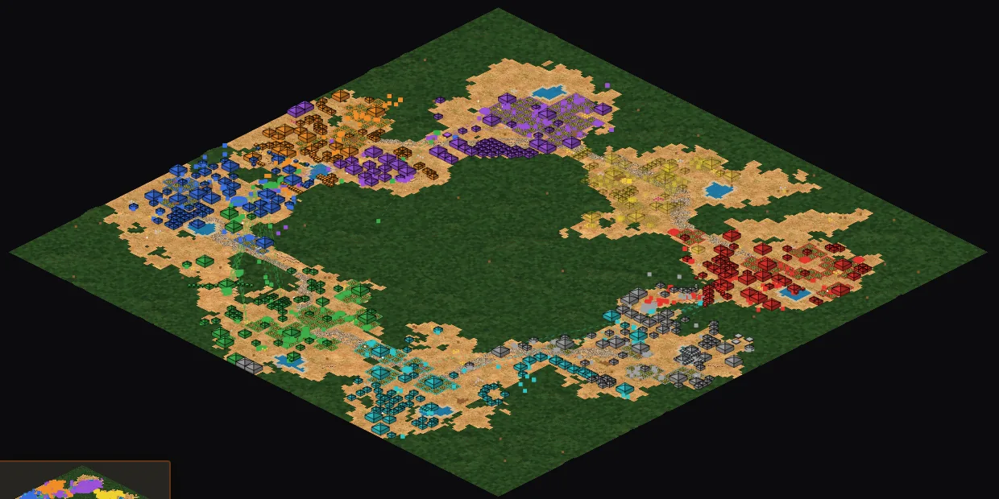
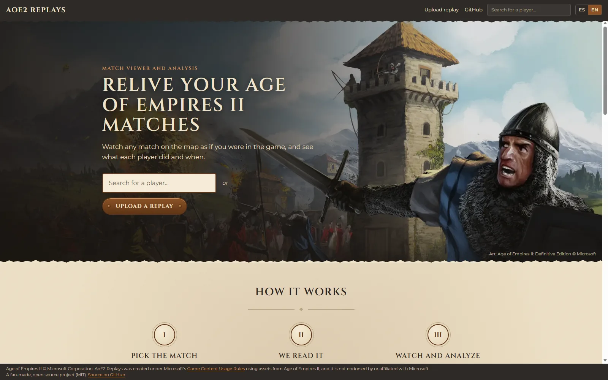

# AoE2 Replays

**Mirá y analizá partidas de Age of Empires II: Definitive Edition en el navegador.**

Subí un replay o buscá a cualquier jugador, y reproducí su partida en el mapa con los gráficos del juego: la arquitectura de cada civilización, aldeanos trabajando, ejércitos en marcha. Después mirá qué hizo cada jugador y cuándo.

[**Abrir la web →**](https://aoe2replays.sitemaster.com.ar/) · [English](README.md) · [Cómo colaborar](CONTRIBUTING.md)

## Qué hace

| | |
|---|---|
|  | **Mirala como en el juego.** Vista isométrica con los sprites del juego: edificios por civilización y edad, aldeanos talando, minando, cultivando y construyendo, unidades que salen del edificio correcto, árboles que caen a medida que se talan. La cámara sigue la acción sola, o al jugador que elijas. |
|  | **Todo el mapa de un vistazo.** Alejate para ver cómo se reparte el mapa, saltá a cualquier lugar con el minimapa y a cualquier momento con la línea de tiempo. Compartí un momento con `?t=<segundos>`. |
|  | **Partidas online sin subir nada.** Buscá a cualquier jugador (con autocompletado), mirá sus rankings y partidas recientes y abrí cualquiera: el replay se descarga del servicio público de replays de Microsoft. |

Y además:
- **Análisis**: APM, cuándo hizo clic cada jugador en cada edad, actividad a lo largo de la partida y build order de cada uno, con salto al momento exacto.
- **Chat** con salto al momento en que se escribió cada mensaje.
- **Preguntale a una IA**: copiá la partida como texto (resumen o todas las órdenes) para pegarla en ChatGPT, Claude u otra IA.
- **Privado por defecto**: los replays subidos solo se ven con su enlace de gestión hasta que los hagas públicos; se guardan solo los datos de la partida (nunca el archivo) y se borran a los 30 días.
- **Español e inglés**, según tu navegador, con cambio de idioma en cualquier momento.

### Qué es exacto y qué es estimado
Un replay guarda **solo las órdenes de los jugadores**: el juego vuelve a simular todo con su motor, que es cerrado. Por eso las órdenes, los tiempos, qué se construyó y dónde, las investigaciones, los abandonos y el chat son **exactos**; los recorridos de las unidades, la recolección, la tala, los combates y la llegada a cada edad son **estimaciones**, y la web lo aclara donde importa.

## Cómo está hecho

| Carpeta | Qué es | Stack |
|---|---|---|
| [`services/parser`](services/parser) | Lee el `.aoe2record` a un JSON documentado. CLI y API HTTP | Python, FastAPI, [`mgz`](https://github.com/happyleavesaoc/aoc-mgz) (con parches para versiones recientes) |
| [`apps/web`](apps/web) | La web: portada, subidas, buscador, partidas, visor, análisis | Next.js, TypeScript, Prisma, PostgreSQL |
| [`packages/viewer`](packages/viewer) | Motor de reproducción (estima movimiento, recolección, construcción) y render isométrico en canvas | JavaScript sin dependencias |
| [`packages/shared`](packages/shared) | Tipos del formato JSON del parser | TypeScript |
| [`tools/sprites`](tools/sprites) | Extrae los gráficos (SLD) y datos del juego a atlas WebP | Python |

## Correrlo localmente
Requisitos: Python 3.11+, Node 22+ y Docker (para la base de datos). Los pasos son los mismos del [README en inglés](README.md#run-it-locally); la guía de despliegue está en [`docs/DEPLOY.md`](docs/DEPLOY.md).

## Colaborar
Las mejoras son bienvenidas y cada pull request se revisa. Empezá por [`CONTRIBUTING.md`](CONTRIBUTING.md) (y [`AGENTS.md`](AGENTS.md) si usás un agente de código). La hoja de ruta está en [`tasks/`](tasks), empezando por [`tasks/PENDIENTES.md`](tasks/PENDIENTES.md). ¿Encontraste un problema de seguridad? Mirá [`SECURITY.md`](SECURITY.md).

## Créditos y legales
- Lectura de replays: [`mgz`](https://github.com/happyleavesaoc/aoc-mgz) de happyleavesaoc (MIT) y datos de referencia de [aoc-reference-data](https://github.com/SiegeEngineers/aoc-reference-data).
- Datos de jugadores y partidas: [aoe2companion](https://www.aoe2companion.com).
- Lectura del archivo de datos del juego para la herramienta de sprites: [genieutils-py](https://github.com/SiegeEngineers/genieutils-py) (LGPL, solo herramienta de desarrollo).
- Fuentes: Cinzel y Montserrat (SIL Open Font License).

Age of Empires II © Microsoft Corporation. AoE2 Replays se creó bajo las "[Game Content Usage Rules](https://www.xbox.com/en-US/developers/rules)" de Microsoft usando contenido de Age of Empires II, y no está respaldado ni afiliado a Microsoft. El arte y los sprites del juego **no** están cubiertos por la licencia del proyecto; ver [`apps/web/public/images/CREDITS.md`](apps/web/public/images/CREDITS.md).

El código se publica bajo la [licencia MIT](LICENSE).
