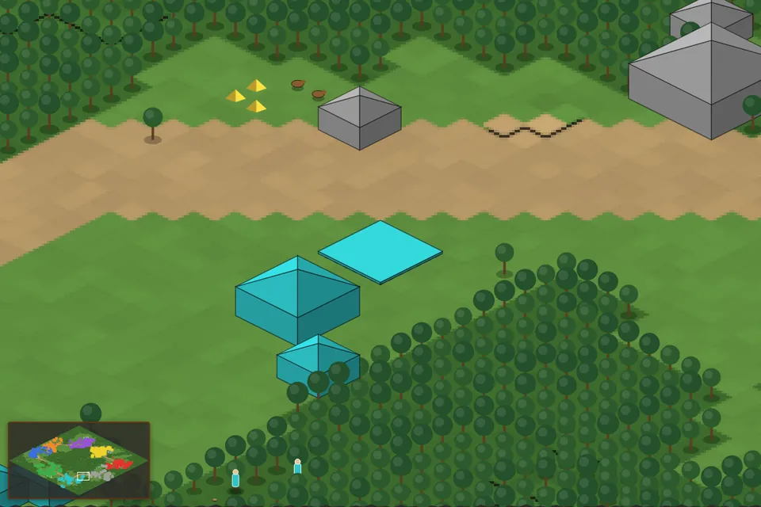

# AoE2 Replays

Visor y herramienta de análisis open source para partidas de **Age of Empires II: Definitive Edition**.

Subí un replay (`.aoe2record`) o buscá a un jugador y abrí cualquiera de sus partidas online: se reproduce en un mapa isométrico, con la cámara siguiendo la acción, y podés analizar qué hizo cada jugador y cuándo.

> Proyecto de fans. Age of Empires II © Microsoft Corporation. AoE2 Replays se creó bajo las [Game Content Usage Rules](https://www.xbox.com/en-US/developers/rules) de Microsoft usando contenido de Age of Empires II, y no está respaldado ni afiliado a Microsoft.



## Qué hace
- **Visor**: mapa isométrico con relieve, edificios que se construyen, unidades que se mueven, árboles que se talan y recursos que se agotan. Cámara automática que sigue la acción, seguimiento de un jugador, minimapa y línea de tiempo.
- **Análisis**: APM, momento de avance a cada edad, actividad a lo largo de la partida y build order de cada jugador.
- **Chat**: todos los mensajes de la partida, y salto al momento en que se escribieron.
- **Contexto para IA**: la partida como texto para pegar en ChatGPT, Claude u otra IA y hacerle preguntas.
- **Partidas online**: búsqueda de jugadores con autocompletado, perfil con rankings y partidas recientes, y reproducción de cualquiera de ellas sin subir archivos (el replay se descarga del servicio público de Microsoft).
- **Privacidad**: los replays subidos son privados hasta que los hagas públicos, se guardan solo los datos de la partida (no el archivo) y se borran solos.

### Qué es exacto y qué es estimado
Un replay de AoE2 guarda **solo las órdenes de los jugadores**; el juego vuelve a simular todo con su motor, que es cerrado. Por eso:
- **Exacto**: mapa, jugadores, cada orden y su momento, dónde se construyó cada edificio, investigaciones, abandonos, chat.
- **Estimado**: el recorrido de las unidades, la tala y recolección de recursos, la llegada a cada edad, el avance de las construcciones.

## Cómo está hecho
| Carpeta | Qué es | Stack |
|---|---|---|
| [`services/parser`](services/parser) | Convierte un `.aoe2record` en JSON. CLI y API HTTP | Python, FastAPI, [`mgz`](https://github.com/happyleavesaoc/aoc-mgz) (con parches para versiones nuevas) |
| [`apps/web`](apps/web) | Web: subida, partidas online, visor, análisis | Next.js, TypeScript, Prisma, PostgreSQL |
| [`packages/viewer`](packages/viewer) | Motor de reproducción y análisis + render en canvas | JavaScript (sin dependencias) |
| [`packages/shared`](packages/shared) | Tipos del formato JSON del parser | TypeScript |
| [`apps/viewer`](apps/viewer) | Prototipo estático del visor, para depurar | HTML + JS |

El formato JSON que produce el parser está documentado en [`services/parser/README.md`](services/parser/README.md), por si querés armar tu propio visor.

## Correrlo localmente
Requisitos: Python 3.11+, Node 22+ y Docker (para la base de datos).

```sh
# 1. Parser (terminal 1)
cd services/parser
python -m venv .venv
.venv/Scripts/python -m pip install -e ".[dev]"      # Linux/macOS: .venv/bin/python
.venv/Scripts/python -m uvicorn aoe2_parser.api:app --port 8000

# 2. Base de datos (desde la raíz)
docker compose -f docker-compose.dev.yml up -d       # PostgreSQL en localhost:5433

# 3. Web (terminal 2, desde la raíz)
npm install
cp apps/web/.env.example apps/web/.env.local
npm run db:migrate -w apps/web
npm run dev:web                                      # http://localhost:3000
```

Tests: `npm test` en la raíz y `.venv/Scripts/python -m pytest` dentro de `services/parser`.

Para desplegar (Docker Compose, por ejemplo con Dokploy): [`docs/DEPLOY.md`](docs/DEPLOY.md).

## Contribuir
Las mejoras llegan por pull request y se revisan una por una. Leé [`CONTRIBUTING.md`](CONTRIBUTING.md) y, si usás un agente de código, [`AGENTS.md`](AGENTS.md). La hoja de ruta está en [`tasks/`](tasks), empezando por [`tasks/PENDIENTES.md`](tasks/PENDIENTES.md).

Documentación interna: [contexto](docs/CONTEXT.md), [arquitectura](docs/ARCHITECTURE.md), [decisiones](docs/DECISIONS.md), [guía de estilo](docs/DESIGN.md), [aspectos legales](docs/LEGAL.md).

## Créditos
- Lectura de replays: [`mgz`](https://github.com/happyleavesaoc/aoc-mgz) de happyleavesaoc (MIT) y datos de referencia de [aoc-reference-data](https://github.com/SiegeEngineers/aoc-reference-data).
- Datos de jugadores y partidas: [aoe2companion](https://www.aoe2companion.com).
- Arte del juego: Age of Empires II: Definitive Edition © Microsoft, usado bajo las Game Content Usage Rules (detalle en [`apps/web/public/images/CREDITS.md`](apps/web/public/images/CREDITS.md)).
- Fuentes: Cinzel y Montserrat (SIL Open Font License).

## Licencia
El código es [MIT](LICENSE). El arte y los nombres de Age of Empires pertenecen a Microsoft y **no** están cubiertos por la licencia MIT.
